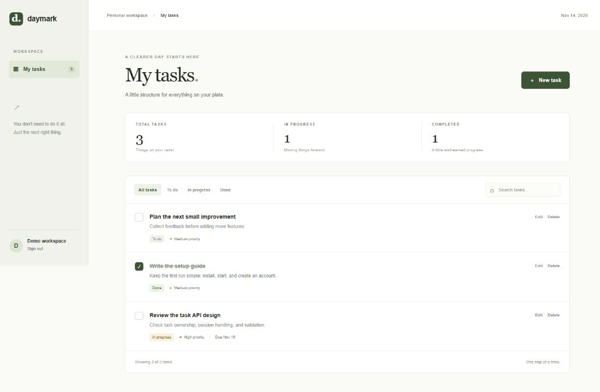

# Daymark

A small task manager with user login, a persistent database, and a responsive browser interface. Built as a complete example of the SaaS feature described in the Adora written assignment.

**[Open the live demo](https://daymark-task-manager-hp2u.onrender.com)** · [Read the full technical design](docs/design.md)

Create a test account to try the app. The free demo may take about a minute to wake after inactivity, and its accounts and tasks can reset after sleep or redeployment.



## Adora written assignment

Responses by Mohammad Owais. All answers are in English.

### Q1. Why do you want to intern at a Japanese startup, and what do you hope to build or learn during the internship?

I want to intern at a Japanese startup because I have already had a chance to work with a Japanese team, and I would like to build on that experience. During my internship at Akatsuki AI, I worked on a healthcare job-search platform and an internal attendance management platform. The work included data pipelines, search and map features, and React and TypeScript interfaces. It gave me a practical reason to be interested in working in Japan: I could see how engineering decisions affected people doing their everyday jobs.

On the job-search platform, I worked on collecting, cleaning, and indexing listings, as well as features that helped career advisors filter results. That experience made me interested in the whole path from messy source data to a useful interface. A search feature is only helpful if the underlying records are reliable and the person using it can find what they need. I would like to keep working on problems where backend correctness and frontend usability matter together.

A startup appeals to me because I want to understand more of the product, take responsibility for a feature, and learn from feedback after it is delivered. At Talendy, my work on deduplication and moving search infrastructure to AWS gave me experience beyond implementing an isolated endpoint. I want to continue developing that ownership while learning from engineers with different experience and perspectives.

During the internship at Adora, I hope to build a small feature from end to end: clarify the requirement, design the data model and API, implement the interface, test failure cases, and improve it based on feedback. I can contribute Python, React, TypeScript, and experience with search and data pipelines. I also want to become better at deciding when a simple solution is enough and when a system needs more structure.

I would like to learn how your team makes product and technical decisions, reviews code, and communicates across roles. Having previously worked remotely with a Japanese company, I am interested in continuing that cross-cultural experience. My goal is to leave the internship with a useful contribution to the product and a better understanding of how to build software that a team can maintain.

### Q2. Design a simple SaaS feature: data model, API endpoints, and frontend structure

For Q2, I built Daymark, a task manager with user login.

Live demo: https://daymark-task-manager-hp2u.onrender.com

Repository: https://github.com/owaish7/daymark-task-manager
Detailed design: https://github.com/owaish7/daymark-task-manager/blob/main/docs/design.md

The feature lets a user register or sign in, create and edit tasks, move them between To do, In progress, and Done, and delete them. Tasks support descriptions, priorities, and optional due dates. The list has status filters, text search, pagination, and summary counts.

#### Data model

- users: id, name, unique case-insensitive email, password_hash, created_at.
- sessions: token_hash, user_id, csrf_token, expires_at.
- tasks: id, user_id, title, description, status, priority, due_date, created_at, updated_at.

A user owns many tasks. Foreign keys link sessions and tasks to users. Database constraints enforce valid statuses and priorities. Titles are required and limited to 160 characters. An index on user_id and creation order supports listing a user's tasks.

#### API endpoints

- POST /api/auth/register: create an account and session.
- POST /api/auth/login: sign in and rotate the current session.
- GET /api/auth/me: restore the current user and CSRF token.
- POST /api/auth/logout: revoke the current session.
- GET /api/tasks: list the signed-in user's tasks, with status, q, limit, and offset parameters.
- POST /api/tasks: create a task.
- GET /api/tasks/:id: read an owned task.
- PATCH /api/tasks/:id: update its editable fields.
- DELETE /api/tasks/:id: delete it.

The server derives the owner from the session and checks ownership on every task operation. Missing and unowned tasks both return 404. Passwords use scrypt hashes. Random session tokens are stored as hashes in SQLite and sent in HttpOnly, SameSite cookies, with Secure enabled for HTTPS. Authenticated writes require a CSRF token, and write endpoints check browser origins.

#### Frontend structure

The frontend contains an authentication view, a workspace with filters and task cards, and dialogs for editing and deletion. I used small JavaScript modules: api.js handles requests and errors; app.js manages the current user, filters, list, and forms. User-provided text is rendered as text rather than HTML. The interface handles loading, empty results, validation errors, expired sessions, and failed requests. Forms disable during saves, and stale search responses cannot replace newer results.

I chose Flask, SQLite, and browser JavaScript to keep the assignment easy to run without cloud credentials or a frontend build step. The repository includes setup instructions, the written design, and 17 passing API integration tests. For a larger deployment, I would add PostgreSQL, shared throttling, monitoring, email verification, and password reset.

See the [full design document](docs/design.md) for field constraints, request/response contracts, security decisions, and tradeoffs.

### Q3. Tell us about a project you have built. What was the hardest problem, and how did you solve it?

One project I built is DevRAG, a PDF question-answering system. It extracts text with page information, creates embeddings, retrieves relevant passages using cosine similarity, and generates answers with page citations. I built the retrieval pipeline directly rather than using a RAG framework because I wanted to understand the individual steps.

The hardest part was making the answer trustworthy, including knowing when the system should not answer. One subtle issue was that the system could retrieve the right passage and still incorrectly refuse a question. For example, a question phrased as “What does Graham say about dollar-cost averaging?” could be rejected even when the relevant passage was ranked first. The passage explained the concept but did not identify its author, so the generator lacked the document-level context needed to connect the question to the evidence.

I investigated retrieval separately from generation. Once I confirmed that the correct passage was present, I changed the indexing and prompt path to preserve the document's title and author alongside the page-level text. This addressed the missing context rather than simply relaxing the grounding rule.

I also found that splitting by a fixed number of sentences could exceed the embedding model's 384-token window and silently truncate content. I replaced that with token-aware chunking and overlapping context. The project's documented comparison found truncation in 9.5% of the original chunks, which the token-aware version eliminated on that document.

The system also has a pre-generation relevance gate, structured citation and grounding fields, and a retrieval evaluation harness. My main lesson was to debug each stage independently: a good final prompt cannot recover missing text or metadata, and a refusal is not necessarily evidence that retrieval failed.

Project: https://github.com/owaish7/devrag

## Run locally

Requires Python 3.12 or newer. No API keys, database server, or frontend build step.

```sh
python -m venv .venv
# Windows PowerShell:
.venv\Scripts\Activate.ps1
# macOS / Linux instead:
# source .venv/bin/activate
python -m pip install -r requirements.txt
python app.py
```

Open **http://127.0.0.1:5000**, create an account, and add a task. Data lives in `instance/tasks.sqlite3` and survives a restart. There are no seeded accounts or hardcoded passwords. Use a test password rather than a password you use elsewhere.

## What works

- Register, sign in, restore a session after refresh, and sign out.
- Add, edit, complete, reopen, or delete your own tasks.
- Set an optional description, priority, and due date.
- Filter by status and search titles/descriptions; results are paginated.
- View total, in-progress, and completed counts across your workspace.
- Get clear loading, empty, validation, and connection-error states.
- Use the interface on a phone or with a keyboard; native dialogs manage modal focus.

## Structure

```text
app.py                  App factory, authentication, task API, security headers
schema.sql              Tables, constraints, foreign keys, indexes
static/index.html       Semantic page and dialogs
static/api.js           Fetch wrapper and in-memory CSRF token
static/app.js           Session restore, UI state, task forms and rendering
static/style.css        Responsive layout and component styles
tests/test_api.py       API integration tests with isolated databases
docs/design.md          Data model, endpoint contract, frontend and tradeoffs
PLAN.md                 Initial scope and implementation sequence
render.yaml             Free hosted-demo configuration
```

## Tests

```sh
python -W error::ResourceWarning -m unittest discover -s tests -v
```

17 integration tests cover the task lifecycle, cross-account isolation, rejected owner injection, persistence across app restarts, expired/revoked/rotated sessions, password/session storage, CSRF and origin checks, duplicate registration, validation, pagination/search, security headers, and authentication rate limiting.

Browser checks were also performed locally for registration, task creation and editing, completion, search, filters, session restore, and sign-out. See `docs/verification.md` for the final verification record.

## Security and deployment notes

Passwords use Werkzeug scrypt hashes. Session cookies are HttpOnly and SameSite=Lax; only SHA-256 hashes of random session tokens are stored in SQLite. Session tokens expire after seven days and sign-out revokes them. Authenticated writes require a CSRF header. All writes check the browser's Origin when present. Task queries always include the signed-in user's ID. User text is rendered with `textContent`, not inserted as HTML.

For a single-instance deployment, use a persistent disk, HTTPS, and Waitress instead of Flask's development server:

```sh
# PowerShell:
$env:COOKIE_SECURE="1"
$env:TASK_DATABASE="C:\persistent-data\daymark.sqlite3"
waitress-serve --host=127.0.0.1 --port=5000 --call app:create_app
```

Place an HTTPS reverse proxy in front of Waitress. It must preserve the public `Host` and provide a trusted HTTPS scheme so same-origin checks match the browser. Only configure proxy headers from a proxy you control. `COOKIE_SECURE=1` is for HTTPS; leave it unset for local HTTP development.

The built-in authentication limiter is bounded and per process, suitable for this small demo. Before an internet-facing launch, add persistent distributed throttling, monitoring, email verification, and password reset. SQLite and per-process throttling are deliberate single-instance limits. The `render.yaml` file configures a free hosted review demo using Waitress, HTTPS-only cookies, and a health check. Its SQLite file is temporary: accounts and tasks can reset when the service sleeps, restarts, or redeploys. The hosted interface shows this limitation. Local SQLite data persists across restarts. For durable hosted SQLite data, attach a persistent disk and set `TASK_DATABASE` to its mount path on a hosting plan that supports it.
